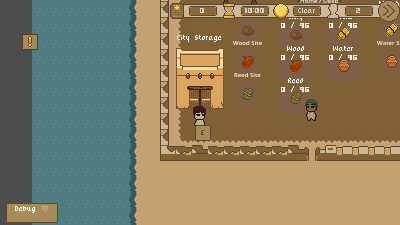
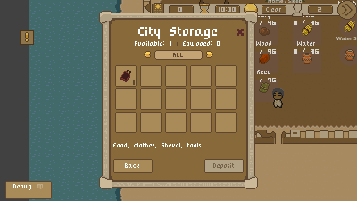
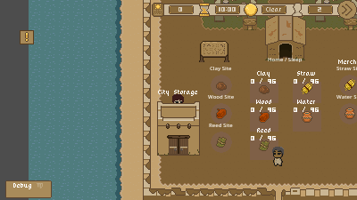

# Warehouse / City Storage integration

Status: implementation validated; human visual review pending. One pre-existing
hauling regression remains (see below).

- Branch: `feature/inventory/warehouse-storage-content`
- Baseline: `50e5c821249fafd4596579766d469647b2d5f59c`; clean starting tree.
- Risk: Level 2, limited scene integration explicitly requested by the Game Director.
- Scope: warehouse presentation, physical collision, access and map placement only.

The baseline still used `assets/objects/house_level_1.png` for City Storage.
The existing area now uses `assets/ui/building/warehouse_leveL_1.png` (48x64).
No additional storage area, provider or interaction dispatcher was introduced.

The existing area origin remains the entrance/Y-sort anchor. The sprite bottom
sits eight pixels above it, with a 46x22 solid lower footprint and a separate
32x24 access zone in front. DeliveryPoint remains at (0,12), inside that zone and
outside the solid footprint. The existing E prompt and six-pixel title remain.
Nearest filtering and the existing YSortWorld/Worksites hierarchy preserve pixel
art and player occlusion behind the building. Main-map placement moves from
(-75,55) to (-120,55) relative to WorkerRuntime, leaving space from the Reed site
and the west wall. Shared fixtures inherit the warehouse visual/collision.

No stock/capacity, economy, filters, save fields, player code, portrait capture,
project settings or TileSet metadata were changed. The editor automatically
extended the translation dialog list during import; that generated change was
restored, not committed. The two unpushed laptop edits were not reconstructed.

## Validation

Godot 4.5.1 official, cloud Linux, GL Compatibility/llvmpipe, isolated Xorg display.
Development window 1200x675; attached PNGs are the real 400x225 viewport captures.
No laptop access or computer-use tool was used. XDG QA data was isolated under /tmp.

- Final editor import/parser: PASS, exit 0, no errors or warnings.
- WarehouseTest: PASS, headless and rendered. Exactly one area, existing provider,
  accessible entrance/delivery point, solid north approach, real E routing,
  repeated open/close and movement restoration, unchanged stock, no rear access.
- CityStorageSupplyFlowTest: PASS, including deposit/no-return, equipment,
  access lifecycle and scene retention.
- CitySaveTest: PASS, including checkpoint roundtrip and rejection cases.
- StartMenuTest empty: PASS.
- PortraitCaptureTest: PASS, including its real map/capture flow.
- CityStorageHaulingTest: FAIL on five obsolete wood_log rejection expectations.
  An isolated checkout at the exact baseline produces the same five errors:
  raw-item acceptance, deposit listing, atomic rejection, direct delivery rejection,
  and pre-pickup rejection. Current raid gameplay intentionally accepts wood_log.
  No hauling/economy code or test expectation was changed in this task.

Rendered checks show the warehouse, E prompt, existing menu and player occlusion.
The software renderer reports unsupported V-Sync; audio uses the dummy driver.
The save regression emits expected warnings for deliberately invalid checkpoints.
An initial sandbox-only run could not bind the existing MCP localhost port;
subsequent cloud runs with network access started it successfully.

Human Windows/Android playtesting and visual acceptance remain unverified.
No merge or force-push is authorized/performed. Keep review based on
`content/portrait-capture`, not main, while the baseline is not merged.

## Evidence

